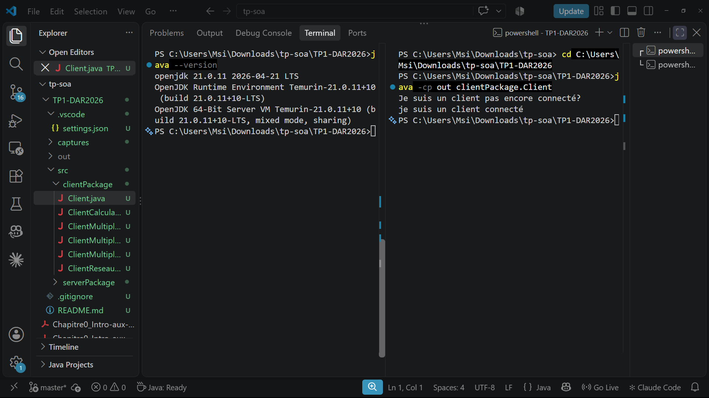
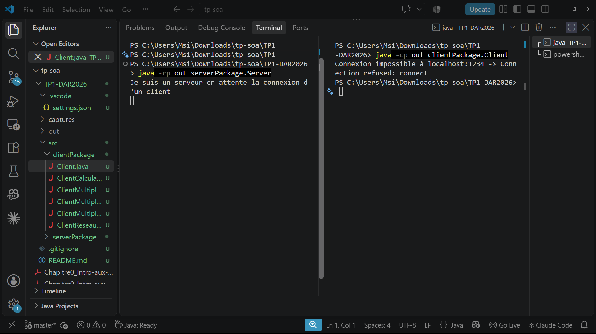
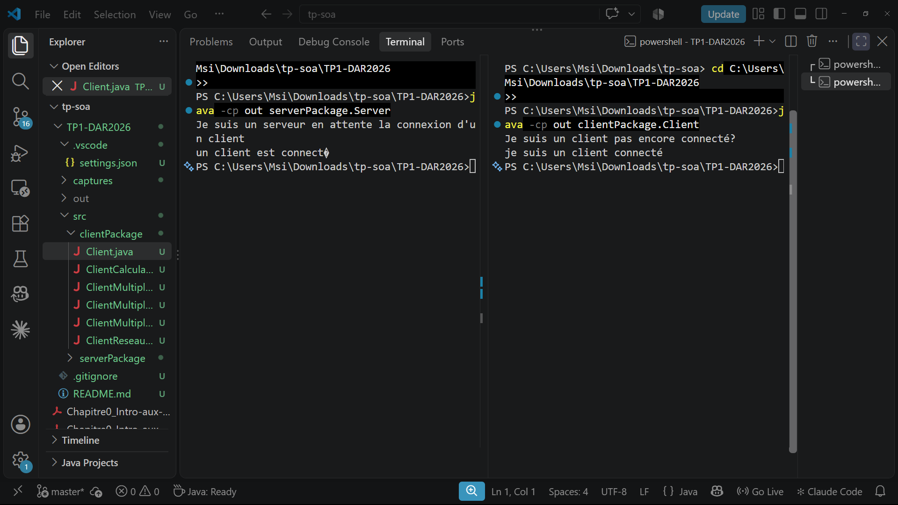
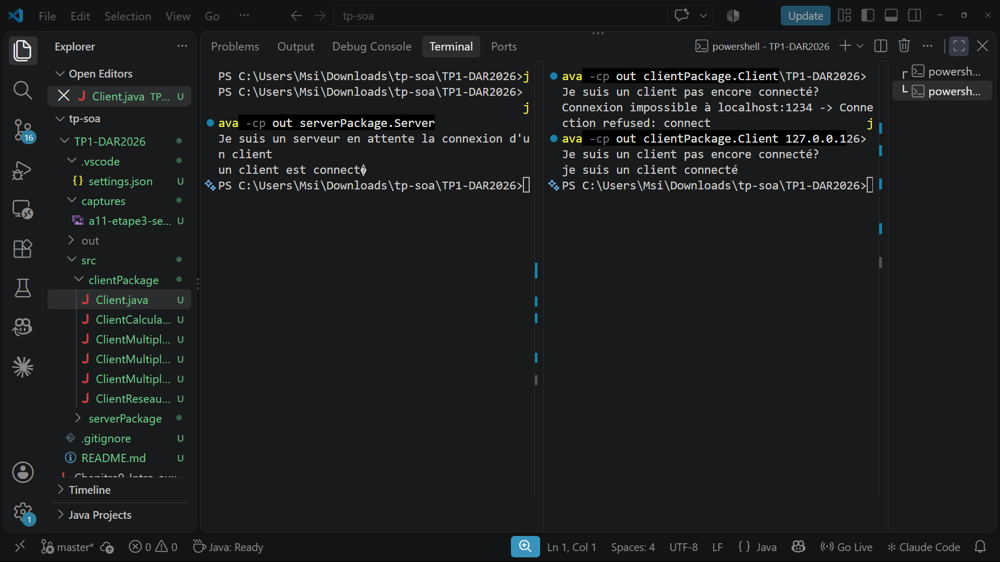
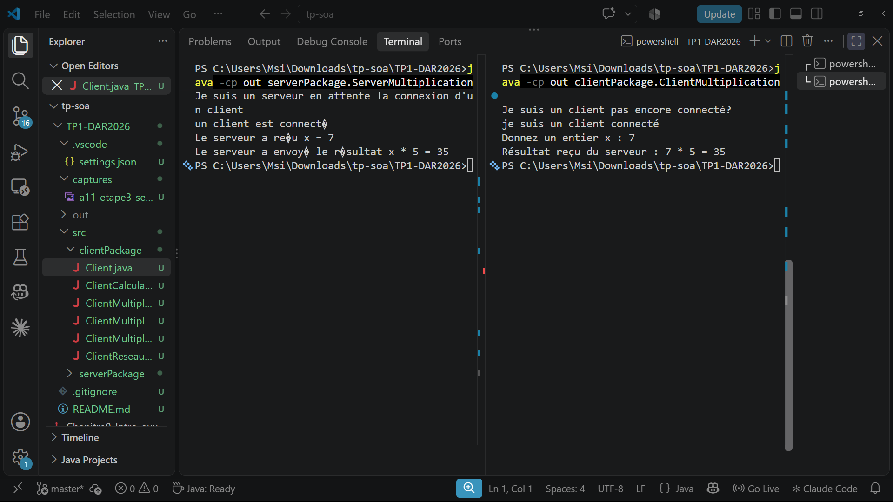
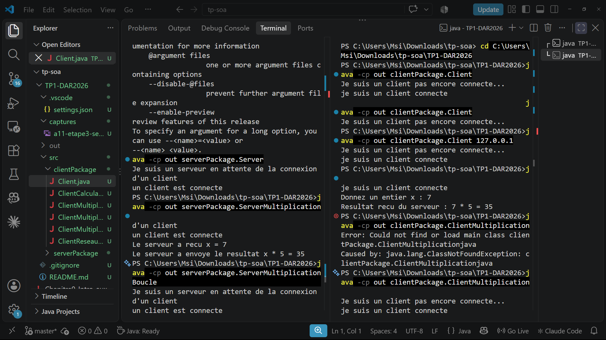

# TP1-DAR2026 — Les sockets en mode connecté TCP

| | |
|---|---|
| **Matière** | Développement d'applications réparties |
| **Auditoire** | LSI 3 — Faculté des Sciences de Sfax |
| **Année universitaire** | 2026 – 2027 |
| **Étudiant(e)** | _Nom Prénom à compléter_ |

Ce dépôt contient le code Java et le compte rendu des trois activités du TP 1 :

- **Activité 1-1** : première connexion Client/Serveur ;
- **Activité 1-2** : service de calculatrice (multiplication `x * 5`) ;
- **Activité 1-3** : connexion entre deux machines distinctes et calculatrice à quatre opérations.

---

## Structure du projet

```
TP1-DAR2026/
├── README.md
├── captures/                                  # captures d'ecran du compte rendu
└── src/
    ├── serverPackage/
    │   ├── Server.java                        # Activite 1-1
    │   ├── ServerMultiplication.java          # Activite 1-2 (Q1-3) : InputStream/OutputStream
    │   ├── ServerMultiplicationData.java      # Activite 1-2 (Q4)   : DataInputStream/DataOutputStream
    │   ├── ServerMultiplicationBoucle.java    # Activite 1-2 (Q5)   : plusieurs entiers, arret sur 0
    │   ├── ServerReseau.java                  # Activite 1-3 (etape 1) : IP reelle + InetSocketAddress
    │   └── ServerCalculatrice.java            # Activite 1-3 (etape 2) : + - * /
    └── clientPackage/
        ├── Client.java
        ├── ClientMultiplication.java
        ├── ClientMultiplicationData.java
        ├── ClientMultiplicationBoucle.java
        ├── ClientReseau.java
        └── ClientCalculatrice.java
```

Chaque version est conservée dans une classe séparée afin de garder une trace du code de chaque étape. Tous les serveurs écoutent sur le **port 1234**.

## Compilation et exécution

Depuis la racine du projet (PowerShell ou terminal de l'IDE) :

```powershell
javac -encoding UTF-8 -d out src/serverPackage/*.java src/clientPackage/*.java
```

Puis, dans **deux terminaux différents** : d'abord le serveur, ensuite le client.

```powershell
java -cp out serverPackage.Server      # terminal 1
java -cp out clientPackage.Client      # terminal 2
```

---

# Activité 1-1 : Première connexion Client/Serveur

## Étape 1 : Préparation de l'environnement Git

Vérification de l'installation de Git :

```
git --version
```

Résultat :

```
git version 2.53.0.windows.1
```

**Interprétation :** la commande affiche la version de Git installée (`git version 2.53.0.windows.1`), ce qui confirme que Git est installé et accessible depuis le `PATH`.

## Étape 2 : Préparation de l'environnement Java

Vérification de la version de Java :

```
java --version
```



Résultat :

```
openjdk 21.0.11 2026-04-21 LTS
OpenJDK Runtime Environment Temurin-21.0.11+10 (build 21.0.11+10-LTS)
OpenJDK 64-Bit Server VM Temurin-21.0.11+10 (build 21.0.11+10-LTS, mixed mode, sharing)
```

**Interprétation :** la commande affiche la version du JDK (`openjdk 21.0.11 2026-04-21 LTS`). La version est bien ≥ 1.8, comme demandé. La commande fonctionne, donc le dossier `bin` du JDK est déjà dans la variable d'environnement `PATH` et aucune modification n'est nécessaire.

Le projet `TP1-DAR2026` est ensuite créé dans le répertoire de travail.

## Étape 3 : Création du serveur

Le projet `TP1-DAR2026` est créé avec un dépôt Git. Le package `serverPackage` contient la classe `Server`, et le package `clientPackage` contient la classe `Client`.

La structure du projet est visible dans l'explorateur de fichiers, à gauche de la capture de l'exécution du serveur ci-dessous.

### Code de la classe `Server` (TODO complétés)

```java
package serverPackage;

import java.io.IOException;
import java.net.ServerSocket;
import java.net.Socket;

/**
 * Activité 1-1 : Première connexion Client/Serveur (sockets TCP).
 * Le serveur attend la connexion d'un seul client, l'accepte puis ferme les sockets.
 */
public class Server {

    public static void main(String[] args) {
        try {
            // La première étape : créer la socket d'écoute sur le port 1234
            ServerSocket serverSocket = new ServerSocket(1234);
            System.out.println("Je suis un serveur en attente de la connexion d'un client ");

            // accept() est bloquante : le serveur reste ici tant qu'aucun client ne se connecte
            Socket socket = serverSocket.accept();

            // La deuxième étape :
            System.out.println("un client est connecte");

            // La dernière étape : Fermer socket
            socket.close();
            serverSocket.close();
        } catch (IOException e) {
            System.err.println("Erreur cote serveur : " + e.getMessage());
        }
    }
}
```

- **Première étape** : `new ServerSocket(1234)` crée la socket d'écoute du serveur et la réserve sur le port 1234.
- **Deuxième étape** : `accept()` attend une demande de connexion. Quand un client arrive, elle renvoie une `Socket` dédiée à la communication avec ce client.
- **Dernière étape** : `close()` ferme la socket de communication puis la socket d'écoute et libère le port.
- Les `IOException` (port déjà utilisé, erreur réseau…) sont capturées dans un bloc `try/catch`.

### Exécution du serveur

```
java -cp out serverPackage.Server
```



**Interprétation :** la console affiche uniquement :

```
Je suis un serveur en attente de la connexion d'un client
```

Le programme ne se termine pas : il est **bloqué sur l'appel `accept()`**, qui est une méthode **bloquante**. Le serveur attend passivement qu'un client se connecte au port 1234. Tant qu'aucun client ne se présente, le message « un client est connecte » n'apparaît pas.

## Étape 4 : Création du client

### Code de la classe `Client` (TODO complétés)

```java
package clientPackage;

import java.io.IOException;
import java.net.Socket;

/**
 * Activité 1-1 : Première connexion Client/Serveur (sockets TCP).
 * Le client se connecte au serveur (port 1234) puis ferme sa socket.
 *
 * Étape 4.f : l'hôte peut être passé en argument pour remplacer "localhost"
 * par une adresse IP, par exemple : java -cp out clientPackage.Client 127.0.0.1
 */
public class Client {

    public static void main(String[] args) {
        // La première étape : définir l'adresse du serveur et le port
        String host = (args.length > 0) ? args[0] : "localhost";
        int port = 1234;
        System.out.println("Je suis un client pas encore connecte...");

        try {
            // Création de la socket = demande de connexion au serveur (host:port)
            Socket socket = new Socket(host, port);
            System.out.println("je suis un client connecte");

            // La dernière étape : Fermer socket
            socket.close();
        } catch (IOException e) {
            System.err.println("Connexion impossible a " + host + ":" + port + " -> " + e.getMessage());
        }
    }
}
```

- **Première étape** : on définit l'adresse du serveur (`localhost` par défaut) et le port (1234), qui doit être le même que celui du serveur.
- `new Socket(host, port)` envoie la demande de connexion TCP. Le constructeur ne rend la main qu'une fois la connexion établie (*three-way handshake* TCP).
- **Dernière étape** : `socket.close()` ferme la connexion.

### Exécution du client (serveur déjà lancé)

```
java -cp out clientPackage.Client
```



Console du serveur :

```
Je suis un serveur en attente de la connexion d'un client
un client est connecte
```

Console du client :

```
Je suis un client pas encore connecte...
je suis un client connecte
```

**Interprétation :**

| Console client | Console serveur |
|---|---|
| `Je suis un client pas encore connecte...` | `Je suis un serveur en attente de la connexion d'un client` |
| `je suis un client connecte` | `un client est connecte` |

1. Le client affiche « pas encore connecte » **avant** de créer la socket.
2. La création de la `Socket` établit la connexion TCP avec le serveur. Le client affiche alors « je suis un client connecte ».
3. Au même moment, `accept()` se débloque côté serveur, qui affiche « un client est connecte ».
4. Les deux programmes ferment ensuite leurs sockets et se terminent.

Le serveur doit **obligatoirement être lancé avant le client**. Si le client est lancé seul, aucune application n'écoute sur le port 1234 et la connexion est refusée. C'est ce que montre le terminal de droite de la capture de l'étape 3, où le client avait été lancé avant le serveur :

```
Je suis un client pas encore connecte...
Connexion impossible a localhost:1234 -> Connection refused: connect
```

### 4.f — Remplacement de `localhost` par une adresse IP

L'adresse du serveur est passée en argument au client, à la place de `localhost` :

```
java -cp out clientPackage.Client 127.0.0.1
java -cp out clientPackage.Client 192.168.1.14
```



Sur la capture, le premier essai (terminal de droite) échoue avec `Connection refused` car le serveur n'était pas encore lancé. Le second essai, avec l'adresse IP en argument, réussit.

Console du client (identique pour `127.0.0.1` et `192.168.1.14`) :

```
Je suis un client pas encore connecte...
je suis un client connecte
```

Console du serveur (identique dans les deux cas) :

```
Je suis un serveur en attente de la connexion d'un client
un client est connecte
```

**Interprétation :** le résultat est identique à celui obtenu avec `localhost`, car `localhost` est un **nom d'hôte** qui se résout en l'adresse de bouclage `127.0.0.1`. L'adresse IP de la carte réseau (obtenue avec `ipconfig`) fonctionne aussi, puisque le serveur écoute sur toutes les interfaces de la machine. C'est cette adresse IP qui permettra à une autre machine de se connecter (Activité 1-3).

## Étape 5 : Dépôt des livrables

Lien du dépôt (déposé sur l'ENT) : _à compléter_

---

# Activité 1-2 : Service de calculatrice

**Énoncé :** le client ne dispose pas de calculatrice. Il envoie un entier `x` au serveur, qui calcule `x * 5` et renvoie le résultat.

## Étape 1 : Préparation de l'espace de travail

Le projet de l'Activité 1-1 est réutilisé. Chaque nouvelle version est ajoutée dans une classe séparée des packages `serverPackage` et `clientPackage` (voir [Structure du projet](#structure-du-projet)).

## Étape 2 : Création du service de multiplication

### Questions 1 à 3 — Première version avec `InputStream` / `OutputStream`

Traitements implémentés :

- **a)** le client tape `x` ;
- **b)** il l'envoie ;
- **c)** le serveur le reçoit ;
- **d)** il calcule `x * 5` ;
- **e)** il renvoie le résultat ;
- **f)** le client le reçoit et l'affiche.

```java
package serverPackage;

import java.io.IOException;
import java.io.InputStream;
import java.io.OutputStream;
import java.net.ServerSocket;
import java.net.Socket;

/**
 * Activité 1-2 (questions 1 à 3) : service de multiplication x * 5.
 * Version 1 : utilisation des flux bruts InputStream / OutputStream.
 * read() et write(int) ne transportent qu'UN SEUL OCTET (0..255) :
 * les entiers négatifs ou supérieurs à 255 sont donc mal transmis.
 */
public class ServerMultiplication {

    public static void main(String[] args) {
        try {
            ServerSocket serverSocket = new ServerSocket(1234);
            System.out.println("Je suis un serveur en attente de la connexion d'un client ");

            Socket socket = serverSocket.accept();
            System.out.println("un client est connecte");

            InputStream is = socket.getInputStream();
            OutputStream os = socket.getOutputStream();

            // c) Le serveur attend puis reçoit le nombre envoyé par le client
            int x = is.read();
            System.out.println("Le serveur a recu x = " + x);

            // d) Le serveur calcule x * 5
            int resultat = x * 5;

            // e) Le serveur envoie le résultat au client
            os.write(resultat);
            System.out.println("Le serveur a envoye le resultat x * 5 = " + resultat);

            socket.close();
            serverSocket.close();
        } catch (IOException e) {
            System.err.println("Erreur cote serveur : " + e.getMessage());
        }
    }
}
```

```java
package clientPackage;

import java.io.IOException;
import java.io.InputStream;
import java.io.OutputStream;
import java.net.Socket;
import java.util.Scanner;

/**
 * Activité 1-2 (questions 1 à 3) : le client demande au serveur de calculer x * 5.
 * Version 1 : flux bruts InputStream / OutputStream (un seul octet transmis).
 */
public class ClientMultiplication {

    public static void main(String[] args) {
        System.out.println("Je suis un client pas encore connecte...");
        try (Scanner clavier = new Scanner(System.in)) {
            Socket socket = new Socket("localhost", 1234);
            System.out.println("je suis un client connecte");

            InputStream is = socket.getInputStream();
            OutputStream os = socket.getOutputStream();

            // a) Le client tape un entier x au clavier
            System.out.print("Donnez un entier x : ");
            int x = clavier.nextInt();

            // b) Le client envoie x au serveur (seul l'octet de poids faible part)
            os.write(x);

            // f) Le client reçoit le résultat
            int resultat = is.read();
            System.out.println("Resultat recu du serveur : " + x + " * 5 = " + resultat);

            socket.close();
        } catch (IOException e) {
            System.err.println("Erreur cote client : " + e.getMessage());
        }
    }
}
```

Exécution (serveur d'abord, puis client), répétée avec `x = 7`, `x = -3`, `x = 0` et `x = 60` :

```
java -cp out serverPackage.ServerMultiplication
java -cp out clientPackage.ClientMultiplication
```



Sorties obtenues (une exécution par valeur) :

```
--- x = 7 ---
[serveur] Le serveur a recu x = 7
[serveur] Le serveur a envoye le resultat x * 5 = 35
[client]  Donnez un entier x : 7
[client]  Resultat recu du serveur : 7 * 5 = 35

--- x = -3 ---
[serveur] Le serveur a recu x = 253
[serveur] Le serveur a envoye le resultat x * 5 = 1265
[client]  Donnez un entier x : -3
[client]  Resultat recu du serveur : -3 * 5 = 241

--- x = 0 ---
[serveur] Le serveur a recu x = 0
[serveur] Le serveur a envoye le resultat x * 5 = 0
[client]  Donnez un entier x : 0
[client]  Resultat recu du serveur : 0 * 5 = 0

--- x = 60 ---
[serveur] Le serveur a recu x = 60
[serveur] Le serveur a envoye le resultat x * 5 = 300
[client]  Donnez un entier x : 60
[client]  Resultat recu du serveur : 60 * 5 = 44
```

**Interprétation des résultats :**

| x saisi | reçu par le serveur | calculé par le serveur | reçu par le client | correct ? |
|---|---|---|---|---|
| 7 | 7 | 35 | **35** | ✅ |
| 0 | 0 | 0 | **0** | ✅ |
| -3 | 253 | 1265 | **241** | ❌ (attendu -15) |
| 60 | 60 | 300 | **44** | ❌ (attendu 300) |

Les valeurs positives petites et zéro donnent un résultat correct, mais **les négatifs et les résultats supérieurs à 255 sont faux**. En effet, `OutputStream.write(int)` n'envoie que **l'octet de poids faible** de l'entier (8 bits). De même, `InputStream.read()` renvoie un octet non signé compris entre 0 et 255 :

- `-3` en complément à deux se termine par l'octet `11111101`. Le serveur le lit comme **253**, puis calcule `253 * 5 = 1265`.
- `1265` ne tient pas sur un octet : seul `1265 mod 256 = 241` est transmis au client.
- `300` devient de la même façon `300 mod 256 = 44`.

Les flux bruts transportent des **octets** et non des entiers Java (4 octets). Il faut donc un flux capable de transmettre des types primitifs.

### Question 4 — Utilisation de `DataInputStream` / `DataOutputStream`

```java
package serverPackage;

import java.io.DataInputStream;
import java.io.DataOutputStream;
import java.io.IOException;
import java.net.ServerSocket;
import java.net.Socket;

/**
 * Activité 1-2 (question 4) : service de multiplication x * 5.
 * Version 2 : DataInputStream / DataOutputStream.
 * readInt() / writeInt() transmettent l'entier complet sur 4 octets
 * (complément à deux), donc les négatifs et les grandes valeurs passent correctement.
 */
public class ServerMultiplicationData {

    public static void main(String[] args) {
        try {
            ServerSocket serverSocket = new ServerSocket(1234);
            System.out.println("Je suis un serveur en attente de la connexion d'un client ");

            Socket socket = serverSocket.accept();
            System.out.println("un client est connecte");

            DataInputStream dis = new DataInputStream(socket.getInputStream());
            DataOutputStream dos = new DataOutputStream(socket.getOutputStream());

            int x = dis.readInt();
            System.out.println("Le serveur a recu x = " + x);

            int resultat = x * 5;
            dos.writeInt(resultat);
            dos.flush();
            System.out.println("Le serveur a envoye le resultat x * 5 = " + resultat);

            socket.close();
            serverSocket.close();
        } catch (IOException e) {
            System.err.println("Erreur cote serveur : " + e.getMessage());
        }
    }
}
```

```java
package clientPackage;

import java.io.DataInputStream;
import java.io.DataOutputStream;
import java.io.IOException;
import java.net.Socket;
import java.util.Scanner;

/**
 * Activité 1-2 (question 4) : le client demande au serveur de calculer x * 5.
 * Version 2 : DataInputStream / DataOutputStream (entier complet sur 4 octets).
 */
public class ClientMultiplicationData {

    public static void main(String[] args) {
        System.out.println("Je suis un client pas encore connecte...");
        try (Scanner clavier = new Scanner(System.in)) {
            Socket socket = new Socket("localhost", 1234);
            System.out.println("je suis un client connecte");

            DataInputStream dis = new DataInputStream(socket.getInputStream());
            DataOutputStream dos = new DataOutputStream(socket.getOutputStream());

            System.out.print("Donnez un entier x : ");
            int x = clavier.nextInt();

            dos.writeInt(x);
            dos.flush();

            int resultat = dis.readInt();
            System.out.println("Resultat recu du serveur : " + x + " * 5 = " + resultat);

            socket.close();
        } catch (IOException e) {
            System.err.println("Erreur cote client : " + e.getMessage());
        }
    }
}
```

```
java -cp out serverPackage.ServerMultiplicationData
java -cp out clientPackage.ClientMultiplicationData
```

Sorties obtenues (une exécution par valeur) :

```
--- x = 7 ---
[serveur] Le serveur a recu x = 7
[serveur] Le serveur a envoye le resultat x * 5 = 35
[client]  Resultat recu du serveur : 7 * 5 = 35

--- x = -3 ---
[serveur] Le serveur a recu x = -3
[serveur] Le serveur a envoye le resultat x * 5 = -15
[client]  Resultat recu du serveur : -3 * 5 = -15

--- x = 0 ---
[serveur] Le serveur a recu x = 0
[serveur] Le serveur a envoye le resultat x * 5 = 0
[client]  Resultat recu du serveur : 0 * 5 = 0

--- x = 60 ---
[serveur] Le serveur a recu x = 60
[serveur] Le serveur a envoye le resultat x * 5 = 300
[client]  Resultat recu du serveur : 60 * 5 = 300
```

**Interprétation :**

| x saisi | reçu par le serveur | reçu par le client |
|---|---|---|
| 7 | 7 | **35** ✅ |
| 0 | 0 | **0** ✅ |
| -3 | -3 | **-15** ✅ |
| 60 | 60 | **300** ✅ |

`writeInt()` écrit l'entier complet sur **4 octets** (big-endian, complément à deux), et `readInt()` lit exactement ces 4 octets pour reconstituer l'`int`. Le signe et les grandes valeurs sont donc conservés : tous les résultats sont maintenant corrects.

### Question 5 — Saisie de plusieurs entiers, arrêt sur 0

```java
package serverPackage;

import java.io.DataInputStream;
import java.io.DataOutputStream;
import java.io.IOException;
import java.net.ServerSocket;
import java.net.Socket;

/**
 * Activité 1-2 (question 5) : service de multiplication x * 5 en boucle.
 * Le serveur traite plusieurs entiers envoyés par le même client
 * et s'arrête proprement lorsqu'il reçoit 0.
 */
public class ServerMultiplicationBoucle {

    public static void main(String[] args) {
        try {
            ServerSocket serverSocket = new ServerSocket(1234);
            System.out.println("Je suis un serveur en attente de la connexion d'un client ");

            Socket socket = serverSocket.accept();
            System.out.println("un client est connecte");

            DataInputStream dis = new DataInputStream(socket.getInputStream());
            DataOutputStream dos = new DataOutputStream(socket.getOutputStream());

            while (true) {
                int x = dis.readInt();
                if (x == 0) {
                    System.out.println("Le client a envoye 0 : fin de la communication.");
                    break;
                }
                int resultat = x * 5;
                dos.writeInt(resultat);
                dos.flush();
                System.out.println("Recu x = " + x + " -> resultat envoye : " + resultat);
            }

            socket.close();
            serverSocket.close();
            System.out.println("Sockets du serveur fermees.");
        } catch (IOException e) {
            System.err.println("Erreur cote serveur : " + e.getMessage());
        }
    }
}
```

```java
package clientPackage;

import java.io.DataInputStream;
import java.io.DataOutputStream;
import java.io.IOException;
import java.net.Socket;
import java.util.Scanner;

/**
 * Activité 1-2 (question 5) : le client saisit plusieurs entiers successivement.
 * Après chaque saisie, il envoie x, reçoit x * 5 et l'affiche.
 * La saisie de 0 termine proprement la communication.
 */
public class ClientMultiplicationBoucle {

    public static void main(String[] args) {
        System.out.println("Je suis un client pas encore connecte...");
        try (Scanner clavier = new Scanner(System.in)) {
            Socket socket = new Socket("localhost", 1234);
            System.out.println("je suis un client connecte");

            DataInputStream dis = new DataInputStream(socket.getInputStream());
            DataOutputStream dos = new DataOutputStream(socket.getOutputStream());

            while (true) {
                System.out.print("Donnez un entier x (0 pour quitter) : ");
                int x = clavier.nextInt();

                dos.writeInt(x);
                dos.flush();

                if (x == 0) {
                    System.out.println("Fin de la communication demandee.");
                    break;
                }

                int resultat = dis.readInt();
                System.out.println("Resultat recu du serveur : " + x + " * 5 = " + resultat);
            }

            socket.close();
            System.out.println("Socket du client fermee.");
        } catch (IOException e) {
            System.err.println("Erreur cote client : " + e.getMessage());
        }
    }
}
```

Exécution avec la suite de saisies `7`, `-3`, `100000`, `0` :

```
java -cp out serverPackage.ServerMultiplicationBoucle
java -cp out clientPackage.ClientMultiplicationBoucle
```



Console du serveur :

```
Je suis un serveur en attente de la connexion d'un client
un client est connecte
Recu x = 7 -> resultat envoye : 35
Recu x = -3 -> resultat envoye : -15
Recu x = 100000 -> resultat envoye : 500000
Le client a envoye 0 : fin de la communication.
Sockets du serveur fermees.
```

**Interprétation :**

```
Donnez un entier x (0 pour quitter) : 7
Resultat recu du serveur : 7 * 5 = 35
Donnez un entier x (0 pour quitter) : -3
Resultat recu du serveur : -3 * 5 = -15
Donnez un entier x (0 pour quitter) : 100000
Resultat recu du serveur : 100000 * 5 = 500000
Donnez un entier x (0 pour quitter) : 0
Fin de la communication demandee.
Socket du client fermee.
```

- Les échanges se font tous sur **la même connexion TCP**. La socket n'est pas recréée à chaque calcul.
- Les deux programmes suivent le même protocole : à chaque tour, le client écrit un `int` et le serveur lit un `int`.
- La valeur `0` sert de **message de fin** : le client l'envoie puis sort de sa boucle sans attendre de réponse. Le serveur sort aussi de sa boucle quand il reçoit 0.
- Les deux côtés ferment ensuite leurs sockets (« Socket du client fermee » / « Sockets du serveur fermees ») : l'arrêt est propre et sans exception.

## Étape 3 : Dépôt des livrables

Le projet est mis à jour sur GitHub, et le lien est déposé sur l'ENT.

---

# Activité 1-3 : Amélioration du service de calculatrice

## Étape 1 : Connexion Client/Serveur sur deux machines distinctes

Dans les activités précédentes, le client et le serveur tournaient sur la même machine (`localhost`). Ici, le serveur s'exécute sur une machine A et le client sur une machine B du **même réseau local**.

- **Côté serveur :** le `ServerSocket` est créé sans adresse, puis lié par `bind()` à un `InetSocketAddress(adresseIP, 1234)`, l'adresse IP réelle de la machine. Elle est donnée en argument ou détectée automatiquement en parcourant les `NetworkInterface`. Les cartes virtuelles (VirtualBox, VPN…) sont ignorées, car elles ne sont pas joignables par les autres machines du réseau.
- **Côté client :** `localhost` est remplacé par l'adresse IP du serveur, saisie au clavier ou passée en argument. La connexion se fait par `socket.connect(new InetSocketAddress(ip, 1234), 5000)`, avec un délai maximal de 5 secondes.

```java
package serverPackage;

import java.io.DataInputStream;
import java.io.DataOutputStream;
import java.io.IOException;
import java.net.Inet4Address;
import java.net.InetAddress;
import java.net.InetSocketAddress;
import java.net.NetworkInterface;
import java.net.ServerSocket;
import java.net.Socket;
import java.net.SocketException;
import java.net.UnknownHostException;
import java.util.Collections;

/**
 * Activité 1-3 (étape 1) : connexion Client/Serveur sur deux machines distinctes.
 * Le ServerSocket est lié (bind) à l'adresse IP réelle de la machine (et non plus à localhost)
 * grâce à InetAddress et InetSocketAddress.
 *
 * Utilisation : java -cp out serverPackage.ServerReseau [adresseIP]
 * Sans argument, la première adresse IPv4 du réseau local détectée est utilisée.
 */
public class ServerReseau {

    private static final int PORT = 1234;

    public static void main(String[] args) {
        try {
            InetAddress ip = (args.length > 0) ? InetAddress.getByName(args[0]) : trouverAdresseLocale();
            InetSocketAddress adresseEcoute = new InetSocketAddress(ip, PORT);

            ServerSocket serverSocket = new ServerSocket();
            serverSocket.bind(adresseEcoute);
            System.out.println("Nom de la machine serveur : " + InetAddress.getLocalHost().getHostName());
            System.out.println("Serveur a l'ecoute sur " + ip.getHostAddress() + ":" + PORT);
            System.out.println("Je suis un serveur en attente de la connexion d'un client ");

            Socket socket = serverSocket.accept();
            InetSocketAddress adresseClient = (InetSocketAddress) socket.getRemoteSocketAddress();
            System.out.println("un client est connecte depuis "
                    + adresseClient.getAddress().getHostAddress() + ":" + adresseClient.getPort());

            DataInputStream dis = new DataInputStream(socket.getInputStream());
            DataOutputStream dos = new DataOutputStream(socket.getOutputStream());

            while (true) {
                int x = dis.readInt();
                if (x == 0) {
                    System.out.println("Le client a envoye 0 : fin de la communication.");
                    break;
                }
                int resultat = x * 5;
                dos.writeInt(resultat);
                dos.flush();
                System.out.println("Recu x = " + x + " -> resultat envoye : " + resultat);
            }

            socket.close();
            serverSocket.close();
            System.out.println("Sockets du serveur fermees.");
        } catch (IOException e) {
            System.err.println("Erreur cote serveur : " + e.getMessage());
        }
    }

    /**
     * Parcourt les interfaces réseau actives et affiche les adresses IPv4 disponibles.
     * Retourne la première adresse privée d'une carte physique (Wi-Fi / Ethernet),
     * en ignorant les cartes virtuelles (VirtualBox, VMware, Hyper-V, VPN...).
     * Si la détection ne convient pas, passer l'adresse IP voulue en argument.
     */
    static InetAddress trouverAdresseLocale() throws SocketException, UnknownHostException {
        InetAddress choisie = null;
        System.out.println("Adresses IPv4 disponibles sur cette machine :");
        for (NetworkInterface ni : Collections.list(NetworkInterface.getNetworkInterfaces())) {
            if (!ni.isUp() || ni.isLoopback() || ni.isVirtual()) {
                continue;
            }
            String nom = ni.getDisplayName().toLowerCase();
            boolean carteVirtuelle = nom.matches(".*(virtual|vmware|vbox|hyper-v|zerotier|tailscale|vpn|tap|tun).*");
            for (InetAddress adr : Collections.list(ni.getInetAddresses())) {
                if (adr instanceof Inet4Address && adr.isSiteLocalAddress()) {
                    System.out.println("  - " + adr.getHostAddress() + " (" + ni.getDisplayName() + ")"
                            + (carteVirtuelle ? " [virtuelle, ignoree]" : ""));
                    if (choisie == null && !carteVirtuelle) {
                        choisie = adr;
                    }
                }
            }
        }
        return (choisie != null) ? choisie : InetAddress.getLocalHost();
    }
}
```

```java
package clientPackage;

import java.io.DataInputStream;
import java.io.DataOutputStream;
import java.io.IOException;
import java.net.InetAddress;
import java.net.InetSocketAddress;
import java.net.Socket;
import java.util.Scanner;

/**
 * Activité 1-3 (étape 1) : le client se connecte au serveur situé sur une AUTRE machine.
 * "localhost" est remplacé par l'adresse IP de la machine serveur.
 *
 * Utilisation : java -cp out clientPackage.ClientReseau [adresseIPServeur]
 * Sans argument, l'adresse IP est demandée au clavier.
 */
public class ClientReseau {

    private static final int PORT = 1234;

    public static void main(String[] args) {
        try (Scanner clavier = new Scanner(System.in)) {
            String ipServeur;
            if (args.length > 0) {
                ipServeur = args[0];
            } else {
                System.out.print("Adresse IP du serveur : ");
                ipServeur = clavier.nextLine().trim();
            }

            InetSocketAddress adresseServeur = new InetSocketAddress(InetAddress.getByName(ipServeur), PORT);
            System.out.println("Je suis un client pas encore connecte...");

            Socket socket = new Socket();
            socket.connect(adresseServeur, 5000); // délai maximal de connexion : 5 secondes
            System.out.println("je suis un client connecte au serveur "
                    + adresseServeur.getAddress().getHostAddress() + ":" + PORT
                    + " depuis " + socket.getLocalAddress().getHostAddress() + ":" + socket.getLocalPort());

            DataInputStream dis = new DataInputStream(socket.getInputStream());
            DataOutputStream dos = new DataOutputStream(socket.getOutputStream());

            while (true) {
                System.out.print("Donnez un entier x (0 pour quitter) : ");
                int x = clavier.nextInt();

                dos.writeInt(x);
                dos.flush();

                if (x == 0) {
                    System.out.println("Fin de la communication demandee.");
                    break;
                }

                int resultat = dis.readInt();
                System.out.println("Resultat recu du serveur : " + x + " * 5 = " + resultat);
            }

            socket.close();
            System.out.println("Socket du client fermee.");
        } catch (IOException e) {
            System.err.println("Erreur cote client : " + e.getMessage());
        }
    }
}
```

Le serveur affiche lui-même les adresses IPv4 de sa machine (équivalent de `ipconfig`), puis le client se connecte à l'adresse affichée :

```
java -cp out serverPackage.ServerReseau                # machine A (serveur)
java -cp out clientPackage.ClientReseau 192.168.1.14   # machine B (client)
```

Console du serveur :

```
Adresses IPv4 disponibles sur cette machine :
  - 10.80.36.106 (ZeroTier Virtual Port) [virtuelle, ignoree]
  - 192.168.56.1 (VirtualBox Host-Only Ethernet Adapter) [virtuelle, ignoree]
  - 192.168.1.14 (Intel(R) Wi-Fi 6 AX201 160MHz)
Nom de la machine serveur : Hrizz
Serveur a l'ecoute sur 192.168.1.14:1234
Je suis un serveur en attente de la connexion d'un client
un client est connecte depuis 192.168.1.14:61192
Recu x = 7 -> resultat envoye : 35
Recu x = -3 -> resultat envoye : -15
Le client a envoye 0 : fin de la communication.
Sockets du serveur fermees.
```

Console du client :

```
Je suis un client pas encore connecte...
je suis un client connecte au serveur 192.168.1.14:1234 depuis 192.168.1.14:61192
Donnez un entier x (0 pour quitter) : 7
Resultat recu du serveur : 7 * 5 = 35
Donnez un entier x (0 pour quitter) : -3
Resultat recu du serveur : -3 * 5 = -15
Donnez un entier x (0 pour quitter) : 0
Fin de la communication demandee.
Socket du client fermee.
```

> Ce test a été exécuté avec le client et le serveur sur la même machine, en passant par l'adresse IP Wi-Fi `192.168.1.14` (et non `localhost`). C'est pourquoi l'adresse du client affichée est la même que celle du serveur. Avec une seconde machine B, le serveur afficherait l'adresse IP de B.

**Interprétation :**

- Le serveur affiche ses adresses IPv4 et indique sur laquelle il écoute, par exemple `Serveur a l'ecoute sur 192.168.1.14:1234`.
- Quand le client de la machine B se connecte, le serveur affiche `un client est connecte depuis <IP de la machine B>:<port>`. L'adresse affichée est **différente** de celle du serveur : la communication passe bien par le réseau local et non plus par l'adresse de bouclage.
- Le port du client (ex. `53190`) est un **port éphémère** choisi automatiquement par le système, alors que le port du serveur (1234) est fixe et connu à l'avance.
- Le service `x * 5` fonctionne exactement comme dans l'Activité 1-2. Seule l'adresse change : le code de communication (flux `Data*`) est indépendant de l'emplacement des machines.

> **Remarque :** au premier lancement du serveur, le pare-feu Windows demande l'autorisation pour Java. Il faut l'autoriser sur les **réseaux privés**, sinon le client obtient un `Connect timed out`. Si le serveur écoute sur une adresse que la machine B ne peut pas atteindre, le client reçoit `Connection refused` ou `timed out`.

## Étape 2 : Service de calculatrice amélioré

Le serveur offre maintenant quatre opérations : **addition, soustraction, multiplication et division**. Le client affiche un menu, envoie le choix et les opérandes, puis affiche le résultat calculé par le serveur.

Protocole d'échange défini entre le client et le serveur :

| Sens | Données | Méthodes |
|---|---|---|
| Client → Serveur | choix (1 = +, 2 = −, 3 = ×, 4 = ÷, 0 = quitter) | `writeInt` / `readInt` |
| Client → Serveur | opérandes `x` et `y` (réels) | `writeDouble` / `readDouble` |
| Serveur → Client | succès ou échec | `writeBoolean` / `readBoolean` |
| Serveur → Client | résultat si succès, message d'erreur sinon | `writeDouble` ou `writeUTF` |

```java
package serverPackage;

import java.io.DataInputStream;
import java.io.DataOutputStream;
import java.io.IOException;
import java.net.InetAddress;
import java.net.InetSocketAddress;
import java.net.ServerSocket;
import java.net.Socket;

/**
 * Activité 1-3 (étape 2) : service de calculatrice amélioré (machines distinctes).
 *
 * Protocole (DataInputStream / DataOutputStream) :
 *   Client -> Serveur : int choix (1=+, 2=-, 3=*, 4=/, 0=quitter), puis double x, double y
 *   Serveur -> Client : boolean succes, puis double resultat (si succes) ou String message d'erreur
 *
 * Utilisation : java -cp out serverPackage.ServerCalculatrice [adresseIP]
 */
public class ServerCalculatrice {

    private static final int PORT = 1234;

    public static void main(String[] args) {
        try {
            InetAddress ip = (args.length > 0)
                    ? InetAddress.getByName(args[0])
                    : ServerReseau.trouverAdresseLocale();

            ServerSocket serverSocket = new ServerSocket();
            serverSocket.bind(new InetSocketAddress(ip, PORT));
            System.out.println("Serveur calculatrice a l'ecoute sur " + ip.getHostAddress() + ":" + PORT);
            System.out.println("Je suis un serveur en attente de la connexion d'un client ");

            Socket socket = serverSocket.accept();
            System.out.println("un client est connecte depuis " + socket.getInetAddress().getHostAddress());

            DataInputStream dis = new DataInputStream(socket.getInputStream());
            DataOutputStream dos = new DataOutputStream(socket.getOutputStream());

            while (true) {
                int choix = dis.readInt();
                if (choix == 0) {
                    System.out.println("Le client a choisi de quitter : fin de la communication.");
                    break;
                }
                double x = dis.readDouble();
                double y = dis.readDouble();

                double resultat;
                String symbole;
                String erreur = null;
                switch (choix) {
                    case 1: symbole = "+"; resultat = x + y; break;
                    case 2: symbole = "-"; resultat = x - y; break;
                    case 3: symbole = "*"; resultat = x * y; break;
                    case 4:
                        symbole = "/";
                        if (y == 0) {
                            resultat = 0;
                            erreur = "Erreur : division par zero impossible";
                        } else {
                            resultat = x / y;
                        }
                        break;
                    default:
                        symbole = "?";
                        resultat = 0;
                        erreur = "Erreur : operation inconnue (" + choix + ")";
                }

                if (erreur == null) {
                    dos.writeBoolean(true);
                    dos.writeDouble(resultat);
                    System.out.println("Demande : " + formater(x) + " " + symbole + " " + formater(y)
                            + " -> resultat envoye : " + formater(resultat));
                } else {
                    dos.writeBoolean(false);
                    dos.writeUTF(erreur);
                    System.out.println("Demande : " + formater(x) + " " + symbole + " " + formater(y)
                            + " -> " + erreur);
                }
                dos.flush();
            }

            socket.close();
            serverSocket.close();
            System.out.println("Sockets du serveur fermees.");
        } catch (IOException e) {
            System.err.println("Erreur cote serveur : " + e.getMessage());
        }
    }

    /** Affiche 12.0 sous la forme 12, et garde les décimales sinon. */
    static String formater(double v) {
        return (v == Math.rint(v) && !Double.isInfinite(v)) ? String.valueOf((long) v) : String.valueOf(v);
    }
}
```

```java
package clientPackage;

import java.io.DataInputStream;
import java.io.DataOutputStream;
import java.io.IOException;
import java.net.InetAddress;
import java.net.InetSocketAddress;
import java.net.Socket;
import java.util.Scanner;

/**
 * Activité 1-3 (étape 2) : client de la calculatrice distante.
 * Le client affiche un menu, envoie le choix et les opérandes au serveur,
 * puis affiche le résultat calculé par le serveur.
 *
 * Utilisation : java -cp out clientPackage.ClientCalculatrice [adresseIPServeur]
 */
public class ClientCalculatrice {

    private static final int PORT = 1234;

    public static void main(String[] args) {
        try (Scanner clavier = new Scanner(System.in)) {
            String ipServeur;
            if (args.length > 0) {
                ipServeur = args[0];
            } else {
                System.out.print("Adresse IP du serveur : ");
                ipServeur = clavier.nextLine().trim();
            }

            System.out.println("Je suis un client pas encore connecte...");
            Socket socket = new Socket();
            socket.connect(new InetSocketAddress(InetAddress.getByName(ipServeur), PORT), 5000);
            System.out.println("je suis un client connecte au serveur " + ipServeur + ":" + PORT);

            DataInputStream dis = new DataInputStream(socket.getInputStream());
            DataOutputStream dos = new DataOutputStream(socket.getOutputStream());

            while (true) {
                afficherMenu();
                int choix = lireEntier(clavier, "Votre choix : ");

                if (choix == 0) {
                    dos.writeInt(0);
                    dos.flush();
                    System.out.println("Fin de la communication demandee.");
                    break;
                }
                if (choix < 1 || choix > 4) {
                    System.out.println("Choix invalide, veuillez reessayer.");
                    continue;
                }

                double x = lireReel(clavier, "Donnez x : ");
                double y = lireReel(clavier, "Donnez y : ");

                // Transmission du choix et des opérandes au serveur
                dos.writeInt(choix);
                dos.writeDouble(x);
                dos.writeDouble(y);
                dos.flush();

                // Réception de la réponse du serveur
                boolean succes = dis.readBoolean();
                String symbole = new String[] {"", "+", "-", "*", "/"}[choix];
                if (succes) {
                    double resultat = dis.readDouble();
                    System.out.println(">>> Resultat recu du serveur : " + formater(x) + " " + symbole + " "
                            + formater(y) + " = " + formater(resultat));
                } else {
                    System.out.println(">>> " + dis.readUTF());
                }
            }

            socket.close();
            System.out.println("Socket du client fermee.");
        } catch (IOException e) {
            System.err.println("Erreur cote client : " + e.getMessage());
        }
    }

    private static void afficherMenu() {
        System.out.println();
        System.out.println("===== Calculatrice distante =====");
        System.out.println("1. Addition");
        System.out.println("2. Soustraction");
        System.out.println("3. Multiplication");
        System.out.println("4. Division");
        System.out.println("0. Quitter");
    }

    private static int lireEntier(Scanner clavier, String message) {
        while (true) {
            System.out.print(message);
            String ligne = clavier.nextLine().trim();
            try {
                return Integer.parseInt(ligne);
            } catch (NumberFormatException e) {
                System.out.println("Veuillez saisir un entier.");
            }
        }
    }

    /** Accepte la virgule ou le point comme séparateur décimal (ex. 2,5 ou 2.5). */
    private static double lireReel(Scanner clavier, String message) {
        while (true) {
            System.out.print(message);
            String ligne = clavier.nextLine().trim().replace(',', '.');
            try {
                return Double.parseDouble(ligne);
            } catch (NumberFormatException e) {
                System.out.println("Veuillez saisir un nombre.");
            }
        }
    }

    private static String formater(double v) {
        return (v == Math.rint(v) && !Double.isInfinite(v)) ? String.valueOf((long) v) : String.valueOf(v);
    }
}
```

Tests effectués : choix invalide (9), `12 + 30`, `5 - (-8)`, `2,5 * 4`, `7 / 2`, `7 / 0`, puis quitter.

```
java -cp out serverPackage.ServerCalculatrice                # machine A
java -cp out clientPackage.ClientCalculatrice 192.168.1.14   # machine B
```

Console du client (extrait, le menu est réaffiché avant chaque choix) :

```
Je suis un client pas encore connecte...
je suis un client connecte au serveur 192.168.1.14:1234

===== Calculatrice distante =====
1. Addition
2. Soustraction
3. Multiplication
4. Division
0. Quitter
Votre choix : 9
Choix invalide, veuillez reessayer.
...
Votre choix : 1
Donnez x : 12
Donnez y : 30
>>> Resultat recu du serveur : 12 + 30 = 42
...
Votre choix : 2
Donnez x : 5
Donnez y : -8
>>> Resultat recu du serveur : 5 - -8 = 13
...
Votre choix : 3
Donnez x : 2,5
Donnez y : 4
>>> Resultat recu du serveur : 2.5 * 4 = 10
...
Votre choix : 4
Donnez x : 7
Donnez y : 2
>>> Resultat recu du serveur : 7 / 2 = 3.5
...
Votre choix : 4
Donnez x : 7
Donnez y : 0
>>> Erreur : division par zero impossible
...
Votre choix : 0
Fin de la communication demandee.
Socket du client fermee.
```

**Interprétation :**

Console du serveur :

```
Demande : 12 + 30 -> resultat envoye : 42
Demande : 5 - -8 -> resultat envoye : 13
Demande : 2.5 * 4 -> resultat envoye : 10
Demande : 7 / 2 -> resultat envoye : 3.5
Demande : 7 / 0 -> Erreur : division par zero impossible
Le client a choisi de quitter : fin de la communication.
Sockets du serveur fermees.
```

- **Tout le calcul est fait côté serveur.** Le client ne fait que saisir les données, les envoyer et afficher la réponse.
- Le **choix invalide (9)** est filtré par le client avant tout envoi : rien n'est transmis au serveur, et le menu s'affiche de nouveau.
- Les opérandes sont transmis en `double` : la division `7 / 2` donne `3.5` (et non `3` comme avec des entiers), et les décimaux sont acceptés (`2,5` ou `2.5`).
- La **division par zéro** est détectée par le serveur. Il répond `false` suivi d'un message d'erreur au lieu d'un résultat. Le client affiche ce message, et la connexion reste ouverte pour les calculs suivants.
- Le choix `0` termine proprement la communication des deux côtés.

---

## Conclusion

Ce TP a permis de mettre en œuvre la communication **Client/Serveur en mode connecté (TCP)** en Java :

- le serveur crée un `ServerSocket` et attend les clients avec `accept()` (appel bloquant) ;
- le client se connecte avec `Socket` en indiquant l'adresse du serveur et le port ;
- les flux bruts (`InputStream` / `OutputStream`) transportent des octets, ce qui ne suffit pas pour échanger des entiers. `DataInputStream` / `DataOutputStream` permettent d'échanger directement des types primitifs (`int`, `double`, `boolean`, `String`) ;
- un **protocole** commun (ordre et type des messages, message de fin) doit être respecté des deux côtés ;
- `InetAddress` et `InetSocketAddress` permettent de choisir l'adresse IP et le port, et donc de faire communiquer deux machines distinctes d'un réseau local.
